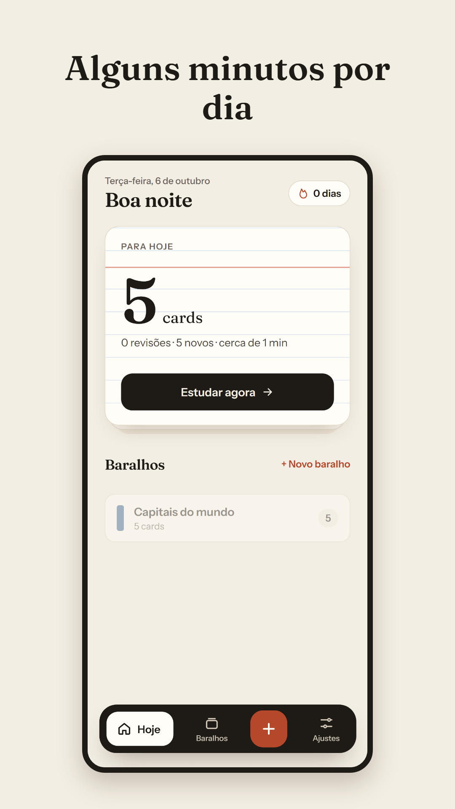
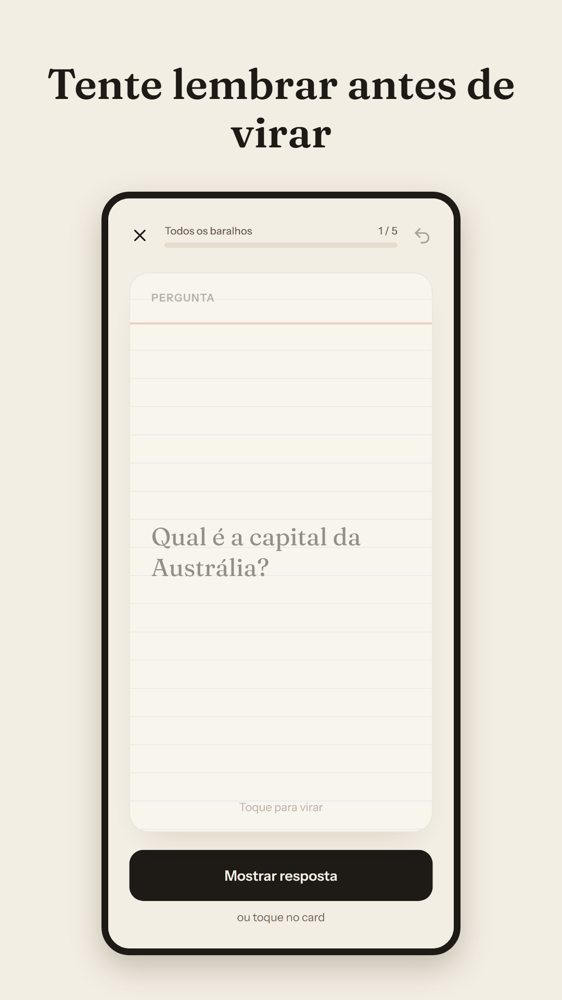
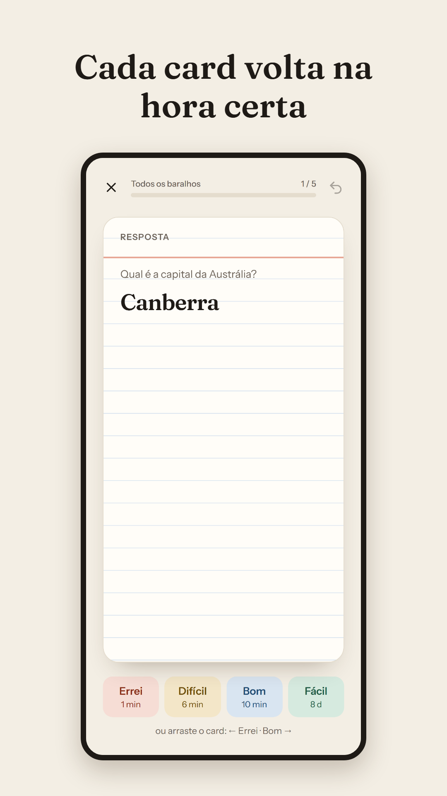
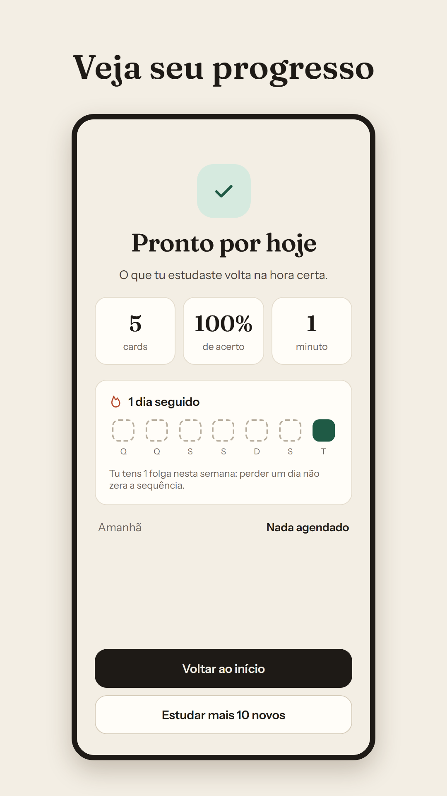

<div align="center">


# Lembra

**Offline spaced-repetition flashcards, as a PWA and an Android app.**

[](https://lembra-nine.vercel.app)


</div>

## About

Anki is powerful, but people give up on it: the review pile grows after a few days away, the settings are confusing and creating cards is slow. Lembra keeps the proven FSRS scheduling and attacks those reasons for quitting: a daily limit set in "minutes per day", cards ordered by how likely you are to forget them, and new cards paused automatically when the backlog grows. It runs fully offline, with all data stored on the device. The interface is in Brazilian Portuguese ("Lembra" means "remembers").

## Features

- Decks and cards, with a card that flips on tap and four answer grades
- Scheduling with the open-source **FSRS** algorithm ([`ts-fsrs`](https://github.com/open-spaced-repetition/ts-fsrs))
- One visible setting, "minutes per day"; everything else lives under "Advanced"
- New cards pause automatically when the review backlog grows, and one rest day per week keeps the streak from punishing you
- "Save and next" flow for fast card creation
- Import decks by pasting JSON or opening a `.json` file, with a preview before saving, so decks generated by other tools can be imported; export a deck through the phone's share sheet
- Local-first: data lives in IndexedDB (Dexie), with automatic backup
- Light, dark and automatic theme
- Installable PWA, plus an Android app built with Capacitor

## Tech stack

| Area | Choice |
|---|---|
| UI | React 19, React Router 7, TypeScript, Motion |
| Build | Vite 7, `vite-plugin-pwa` (service worker and manifest) |
| Data | Dexie 4 (IndexedDB), no backend |
| Scheduling | `ts-fsrs` |
| Mobile | Capacitor 8 |
| Tests | Vitest, Playwright, `fake-indexeddb` |
| CI/CD | GitHub Actions (Android release build, iOS TestFlight build); Vercel hosts the web app |

## Screenshots

<div align="center">




</div>

## Getting started

Requires Node 24 (the version used in CI). No environment variables are needed.

```bash
npm ci
npm run dev          # http://localhost:5173
npm run build        # type-check + production build
npm run preview      # serve the production build
```

## Project structure

```
src/
  domain/   pure logic: scheduler, study queue, streak, card JSON format
  data/     Dexie database: decks, cards, reviews, settings, import/export, backup
  ui/       screens, components, theme tokens, platform helpers
  app/      app shell and routing
e2e/        Playwright end-to-end tests
android/    Capacitor Android project
docs/       design specs, implementation plans and store listing material (Portuguese)
```

The `domain` layer has no React or browser dependencies, so the scheduling and queue rules are tested in isolation.

## Tests

```bash
npm test             # 149 unit tests in 24 files (Vitest)
npm run test:e2e     # 13 Playwright spec files; run `npx playwright install` once first
```

## Roadmap

From the design specs in [`docs/superpowers/specs`](docs/superpowers/specs):

- Accounts and sync across devices
- An MCP server so external tools can create cards
- A community for publishing and subscribing to shared decks

## Author

**Lorenzo Leão Dotto**, full-stack developer.

[](https://lorenzodotto.com.br)
[](https://www.linkedin.com/in/lorenzodotto)
[](https://github.com/DottoLeao)
